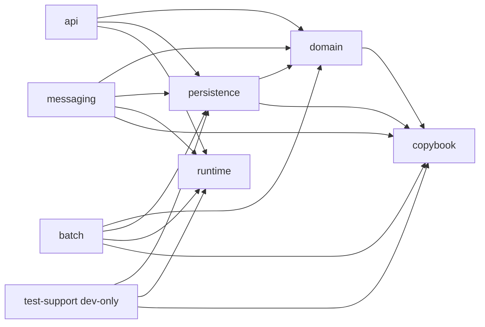

# CardDemo replacement: architecture

This document says where each CardDemo responsibility lives in the Rust, PostgreSQL 16, RabbitMQ 3.13 and React replacement under `modern/`, and which rules keep it there. It is written for an engineer or reviewer who knows the COBOL application. Endpoint details are in [API.md](API.md), environment variables and commands in [SETUP.md](SETUP.md), and the acceptance checklist in [SIGNOFF.md](SIGNOFF.md).

## Contents

1. [Purpose and mapping](#1-purpose-and-mapping)
2. [Crate graph](#2-crate-graph)
3. [Layering rules](#3-layering-rules)
4. [Identity and trust](#4-identity-and-trust)
5. [Audit of writes](#5-audit-of-writes)
6. [Data reach](#6-data-reach)
7. [Shared components](#7-shared-components)
8. [Legacy disposition](#8-legacy-disposition)
9. [Configuration and observability](#9-configuration-and-observability)
10. [Messaging flows](#10-messaging-flows)
11. [Cardholder data redaction](#11-cardholder-data-redaction)
12. [Two transaction-type data versions](#12-two-transaction-type-data-versions)
13. [Where verification lives](#13-where-verification-lives)

## 1. Purpose and mapping

`modern/` sits beside the COBOL tree, which is not retired. The COBOL tree is the permanent, read-only parity oracle: every expected result is derived from it, and it stays byte-unchanged and compilable on a mainframe. The protected paths are `app/{cbl,cpy,bms,jcl,proc,asm,csd,ctl,maclib,scheduler}/**` and `app/data/{ASCII,EBCDIC}/**`. No file outside `modern/` is edited; fixtures and in-stream data are read in place. The source inventory is the Application Inventory of the root [README.md](../../README.md) (`README.md:265-326`).

Each COBOL artefact has exactly one owner in the replacement:

| COBOL artefact | Replacement owner |
|---|---|
| Copybooks (`app/cpy/*.cpy` and the extension `cpy/` folders) | PIC codecs in [`copybook`](../crates/copybook/src/lib.rs); one record struct per layout in [`domain::records`](../crates/domain/src/records/mod.rs) |
| Online programs (`CO*.cbl`) | Pure rules in `domain::online::<program>`, orchestrated by `api::services::<program>`, exposed by thin `api::handlers::<program>` |
| BMS maps (`app/bms/*.bms` and the extension `bms/` folders) | React screens in `frontend/src/screens/`, one per map (21) |
| VSAM KSDS/AIX, IMS `DBPAUTP0`, Db2 tables | PostgreSQL 16 schema in [`crates/persistence/migrations`](../crates/persistence/migrations/) |
| JCL batch jobs | Subcommands of the `carddemo-batch` binary |
| MQ-triggered CICS programs CODATE01, COACCT01, COPAUA0C | The CDRD, CDRA and CP00 workers of the `carddemo-mq` binary |
| COMMAREA ([`COCOM01Y`](../../app/cpy/COCOM01Y.cpy)) | JWT claims (user ID, user type) plus frontend route state (selected account, card `card_ref`, page keys) |
| TDQ `CSSL` (CP00 error log) | Table `cssl_error_log` |
| TDQ `JOBS` (internal reader) | Job-deck files `TRNRPT00.G<nnnn>` in `CARDDEMO_INTRDR_DIR` |

## 2. Crate graph

The Cargo workspace is [`modern/Cargo.toml`](../Cargo.toml) with members `crates/*`. An arrow means "depends on":

| Crate | Role | Binaries |
|---|---|---|
| [`copybook`](../crates/copybook/Cargo.toml) | PIC clause codecs (codec A primitives): `PicX`, `PicU`, `PicS`, `PicDate`, `PicTimestamp`, zoned and packed numerics, edited pictures, `LineFraming`/`Framed`, the `FixedRecord` trait | — |
| [`domain`](../crates/domain/Cargo.toml) | Record structs, money and rate types, sensitive-value types, clock, message literals, password hashing, and every business rule (`online`, `batch`, `messaging`); pure | — |
| [`persistence`](../crates/persistence/Cargo.toml) | The schema source (`migrations/`), one repository trait per table, codec B row mappings, the paginated query files; the only SQL issuer | — |
| [`runtime`](../crates/runtime/Cargo.toml) | Environment configuration, telemetry, `PgPool` construction, generation file naming, the migration entrypoint | `carddemo-migrate` |
| [`api`](../crates/api/Cargo.toml) | axum application, OpenAPI document, JWT, DTOs, services, handlers | `carddemo-api`, `carddemo-openapi` |
| [`messaging`](../crates/messaging/Cargo.toml) | RabbitMQ workers CDRD, CDRA and CP00 | `carddemo-mq` |
| [`batch`](../crates/batch/Cargo.toml) | Command-line program with the 15 job subcommands, PDF rendering | `carddemo-batch` |
| [`test-support`](../crates/test-support/Cargo.toml) | Dev-only harness: testcontainers, fixture paths, audit index, trace capture, child-process runner | — |

- Normal dependencies have no cycles. `runtime` depends on no workspace crate and no HTTP crate, so `carddemo-migrate` builds before any schema exists (section 3.3).
- `persistence` dev-depends on `test-support`, which depends on `persistence`. Cargo allows this dev cycle but compiles `persistence` twice, so `test-support`'s public API exposes only `sqlx`, `lapin` and standard types, plus its own structs built from them, never a `persistence`, `domain` or `copybook` type.
- Versions live only in `[workspace.dependencies]` of `modern/Cargo.toml`, internal path dependencies included; members declare each dependency as `{ workspace = true }`.
- Every member declares `edition.workspace = true`, `rust-version.workspace = true` and `[lints] workspace = true`. The workspace lints forbid `unsafe_code`, deny `warnings`, clippy `pedantic`, `float_arithmetic`, `cast_possible_truncation` and `cast_sign_loss`, and allow nothing. Parsers of external bytes add `#![deny(clippy::unwrap_used, clippy::expect_used, clippy::indexing_slicing)]` at their module root, because an inheriting member cannot add lint entries of its own.

## 3. Layering rules

### 3.1 Pure domain (R3)

- `domain` holds every business rule as a function over typed records. It returns typed outcomes and the exact COBOL message literals, and performs no database, broker, network, filesystem or environment I/O.
- `sqlx` appears in no section of [`crates/domain/Cargo.toml`](../crates/domain/Cargo.toml), so a `use sqlx` in `domain` fails to compile; step 8 of `scripts/check.sh` also scans the dependency tree.
- Time comes only from the injected `Clock` of [`domain/src/clock.rs`](../crates/domain/src/clock.rs): the binaries inject `SystemClock`, tests inject `FixedClock`.
- Money is typed by its picture in [`domain/src/money.rs`](../crates/domain/src/money.rs): `Money<N>`, `Rate<N>` and the exact intermediate `MoneyExpr`, whose only exit is `store::<K>()`. No COBOL source uses `ROUNDED` or `ON SIZE ERROR`, so `store` truncates toward zero at scale 2 and drops high-order digits beyond the receiving width. No floating point exists in financial code (`clippy::float_arithmetic` is denied). The audited statements are in [`audit/arithmetic.md`](../audit/arithmetic.md).

### 3.2 SQL only in `persistence` (R4)

- Every statement is a compile-time-checked macro: `sqlx::query!`, `sqlx::query_as!` or `sqlx::query_scalar!`. The nine paginated reads use `sqlx::query_file_as!` over [`crates/persistence/queries/*.sql`](../crates/persistence/queries/), the same files the `EXPLAIN` test plans.
- Each table has one `<Entity>Repository` trait in [`persistence/src/repos/`](../crates/persistence/src/repos/mod.rs), implemented by `PgStore` (the pool, each statement in autocommit) and `PgTx` (one open transaction). The five traits the single-writer batch jobs use are also implemented by `PgSession`, a detached session that holds the job's writer claim as a PostgreSQL advisory lock. Test doubles implement the same traits.
- `api`, `messaging` and `batch` call those traits only. None of them names a `sqlx` type: the pool from `runtime::db::connect`, or for `carddemo-api` from `runtime::db::connect_for_requests`, is passed straight to `PgStore`; `carddemo-api` also gates its store with `PgStore::failing_fast_while` on the pool's refusal report, a `runtime` type.
- The query metadata in [`modern/.sqlx/`](../.sqlx/) is committed and used with `SQLX_OFFLINE=true` wherever no migrated database is reachable.
- [`persistence::error`](../crates/persistence/src/error.rs) maps every database error to a `PersistenceError` that carries only an SQLSTATE and a constraint name, because PostgreSQL's message and detail texts can quote key values.

### 3.3 Single schema executor

- The only `sqlx::migrate!("../persistence/migrations")` is in [`crates/runtime/src/migrate.rs`](../crates/runtime/src/migrate.rs), behind `runtime::migrate::apply(&PgPool)`. [`runtime/build.rs`](../crates/runtime/build.rs) emits `cargo:rerun-if-changed=../persistence/migrations`, so the embedded set always matches the directory.
- The entrypoint lives in `runtime` because `runtime` has no query macros: it builds against an empty database, so a fresh checkout creates its schema before `persistence`, whose macros need that schema or `.sqlx/`, is compiled.
- It has exactly two callers: the operator binary [`carddemo-migrate`](../crates/runtime/src/bin/carddemo-migrate.rs) and the container harness [`test-support::postgres`](../crates/test-support/src/postgres.rs). `carddemo-api`, `carddemo-mq` and `carddemo-batch` never migrate; started against an unmigrated database, they fail at their first query. sqlx-cli is used only for `prepare`, never for `migrate run`.
- The migrations directory is the only source of schema shape. `.sqlx/` is derived from it by `cargo sqlx prepare --workspace -- --all-targets` and never edited by hand.
- Expand, then contract: this release's six migrations only create, and step 6 of `scripts/check.sh` rejects any drop, rename or retype. [`crates/persistence/tests/explain.rs`](../crates/persistence/tests/explain.rs) plans the previous release's query set from [`crates/persistence/compat/previous/`](../crates/persistence/compat/previous/), whose [`BASELINE.md`](../crates/persistence/compat/previous/BASELINE.md) declares the baseline as commit `59cc6c2` with an empty query set and gives the procedure each later release follows.

### 3.4 Thin request handlers

- Each handler in `api/src/handlers/<program>.rs` does three things: it extracts the validated DTO and the `SignedOnUser` or `AdminUser`, calls one function of `api/src/services/<program>.rs`, and maps the result through the `From` conversions of `api/src/dto/<program>.rs` and [`api/src/error.rs`](../crates/api/src/error.rs).
- A handler does no arithmetic on domain values, holds no `match` on a domain outcome, composes no message and contains no `persistence`, `sqlx` or query text. Step 6 of `scripts/check.sh` scans the handlers for the last of these.
- A service loads through the repository traits, applies the `domain::online::<program>` rules, persists what they decide and returns the domain outcome. Services live in `api` rather than `domain` because `domain` is pure and cannot reach the store. They are `pub(crate)`: only the handlers, which [`api::app::router`](../crates/api/src/app.rs) registers, call them.

## 4. Identity and trust

The COBOL sets the user ID and user type in the COMMAREA at sign-on ([`app/cbl/COSGN00C.cbl:224-228`](../../app/cbl/COSGN00C.cbl)) and never takes them from screen input. The replacement keeps that rule with verified claims:

| Layer | Identity an operation runs for | Source | Caller may supply? |
|---|---|---|---|
| Frontend (`frontend/`) | The signed-on user | The JWT returned by endpoint 1, held in `sessionStorage` by [`src/auth/session.ts`](../frontend/src/auth/session.ts) and attached as a bearer token by [`src/api/client.ts`](../frontend/src/api/client.ts) | The stored user type only chooses navigation; it is never authoritative |
| API (`crates/api`) | The signed-on user: claims `sub` (user ID) and `usr_type` | Verified JWT claims only, through [`api::auth::extract`](../crates/api/src/auth/extract.rs)`::{SignedOnUser, AdminUser}` | Not for the acting identity, which never comes from a body, query string or other header. Data that names users (sign-on credentials on endpoint 1; target user ID, names, type and password on endpoints 17–20; the start user ID on endpoint 16) is validated input and grants no authority |
| Messaging (`crates/messaging`) | A system actor named by its COBOL transaction ID (`CP00`, `CDRA`, `CDRD`); CP00 records it in `cssl_error_log.err_application` | Fixed per worker | Requests carry no user identity, and no MQMD user check is added because the COBOL has none. The trust boundary is the broker account in [`rabbitmq/definitions.json`](../rabbitmq/definitions.json) |
| Batch (`crates/batch`) | The operator running the CLI | The OS process | No application identity; each run records its job name in its job span |

- The admin gate is enforced by the server: `AdminUser` rejects any token whose `usr_type` is not `A` with 403, and every endpoint except sign-on answers 401 without a valid token. The frontend's route guard only hides admin screens; it is not the control.
- The same verified `usr_type` is the only input to endpoint 8's full-card-number disclosure (section 11). No request field can ask for it.

## 5. Audit of writes

No write-audit trail is added, because the COBOL records none for online or batch writes. The one log the source writes is CP00's error log on TDQ `CSSL` (`9500-LOG-ERROR`, [`app/app-authorization-ims-db2-mq/cbl/COPAUA0C.cbl:983-1010`](../../app/app-authorization-ims-db2-mq/cbl/COPAUA0C.cbl)). It becomes the table `cssl_error_log`:

- written only by `messaging::workers::cp00`, through [`persistence::repos::cssl_error_log`](../crates/persistence/src/repos/cssl_error_log.rs);
- each row committed at once in its own transaction, whether or not the operation it records commits, as a `CSSL` write is not part of the CICS unit of work. That transaction is separate from the authorization transaction that holds the i10 summary lock (section 10.3);
- a card-number event key is stored only in its redacted form (section 11).

## 6. Data reach

| Layer | Stores read or written | Access path |
|---|---|---|
| Frontend | The API only | [`src/api/client.ts`](../frontend/src/api/client.ts) (openapi-fetch) |
| API | PostgreSQL: the online tables and `users`. Filesystem: `CARDDEMO_INTRDR_DIR`, where endpoint 14 writes job decks | Repository traits, called only from `api::services::*`; `std::fs` only in `api::services::corpt00c` |
| Messaging | RabbitMQ; PostgreSQL: `card_xref`, `accounts`, `customers`, `pending_auth_summaries`, `pending_auth_details`, `cssl_error_log` | [`messaging::broker`](../crates/messaging/src/broker.rs); repository traits |
| Batch | PostgreSQL: all tables. Filesystem: read-only inputs `app/data/ASCII` and `app/jcl/DUSRSECJ.jcl`, outputs under `CARDDEMO_VAR_DIR` | Repository traits; `std::fs` in `batch::jobs::*` |
| Tests | testcontainers PostgreSQL and RabbitMQ; fixtures read in place | `test-support` |

- The API never publishes to RabbitMQ, because no online transaction sends an MQ message.
- The workers never write files.
- Only `persistence` issues queries.
- A requirement that needs a store its layer cannot reach is served by the layer that can: report execution needs batch outputs, so it is `carddemo-batch tranrept`, run by the operator, not the API. Endpoint 14 only writes the job deck, as `CORPT00C` only wrote to TDQ `JOBS`.
- Schema changes reach PostgreSQL only through `runtime::migrate::apply` (section 3.3).

Output files are local files only, with no object storage. Repeated outputs mirror GDG `(+1)` generations: `DALYREJS.G<nnnn>` (posttran rejects), `SYSTRAN.G<nnnn>` (intcalc system transactions), `TRANREPT.G<nnnn>` (the transaction report) and `TRNRPT00.G<nnnn>` (endpoint 14's job deck) are named by `runtime::gdg::next_generation`, one above the highest generation in the directory, and created without overwriting. `creastmt` writes `STATEMNT.PS`, `STATEMNT.HTML` and `STATEMNT.PDF` in `CARDDEMO_STATEMENT_DIR`. Every job prints each path it wrote, one per line.

## 7. Shared components

A behaviour that files in more than one folder must perform identically lives in exactly one component:

| Behaviour | Component | Provides | Consumers |
|---|---|---|---|
| PIC encoding and decoding, overpunch, edited pictures, line framing | [`crates/copybook/src/{pic,zoned,edited,framing,record}.rs`](../crates/copybook/src/) | `PicX<N>`, `PicU<N>`, `PicS<N>`, `PicDate`, `PicTimestamp`, zoned and packed codecs, `EditedPicture`, `LineFraming`, `Framed`, `FixedRecord` | domain, persistence, messaging (reply bodies), batch (outputs), tests |
| Copybook record structs | [`crates/domain/src/records/*.rs`](../crates/domain/src/records/) | One struct per copybook layout with its `FixedRecord` impl | domain rules, persistence rows and repositories, api, messaging, batch, `test-support::fixtures` (through `persistence`'s re-export) |
| Money, rate and the COBOL store rule | [`domain/src/money.rs`](../crates/domain/src/money.rs) | `Money<N>`, `Rate<N>`, `MoneyExpr`, `store`, `monthly_interest` | domain rules, persistence rows, api DTOs, batch |
| Message literals | [`domain/src/messages.rs`](../crates/domain/src/messages.rs), plus each program module's constants | The exact COBOL texts | api, messaging, batch |
| Current date and time | [`domain/src/clock.rs`](../crates/domain/src/clock.rs) | `Clock`, `SystemClock`, `FixedClock`, the COBOL timestamp renderings | every rule module, tests |
| Password hashing | [`domain/src/password.rs`](../crates/domain/src/password.rs) | argon2id `hash` and `verify` over the eight bytes of `SEC-USR-PWD` | api (sign-on, user add and update), batch `dusrsecj` |
| Sensitive values and their redaction | [`domain/src/sensitive.rs`](../crates/domain/src/sensitive.rs) | `CardNumber`, `Ssn`, `Cvv`, `Password`, `DisclosedCardNumber` | domain records, persistence rows, api DTOs, messaging replies and log rows |
| Highest-plus-one transaction ID | [`persistence/src/repos/transactions.rs`](../crates/persistence/src/repos/transactions.rs) | `TransactionRepository::next_id`, inside the caller's transaction | api endpoints 13 and 15 |
| SQL, repository traits and row mapping | [`persistence/src/repos/*.rs`](../crates/persistence/src/repos/), [`persistence/src/rows/*.rs`](../crates/persistence/src/rows/), [`persistence/queries/*.sql`](../crates/persistence/queries/) | One `<Entity>Repository` per table, `PgStore`, `PgTx`, `PgSession`, codec B | api services, messaging, batch, tests |
| Schema migration | [`runtime/src/migrate.rs`](../crates/runtime/src/migrate.rs) | `apply(&PgPool)`, the only `sqlx::migrate!` | `carddemo-migrate`, `test-support::postgres` |
| Configuration, telemetry, pool | [`runtime/src/config.rs`](../crates/runtime/src/config.rs), [`telemetry.rs`](../crates/runtime/src/telemetry.rs), [`db.rs`](../crates/runtime/src/db.rs) | `Config::from_env()`, `telemetry::init` and the span constructors, `db::connect`, and `db::connect_for_requests` for the api's request pool (5 s acquire timeout on every pool; no pool adds a `lock_timeout` or `statement_timeout`, so a request waits for a row lock another transaction holds, as a CICS `READ UPDATE` does; the request pool's refusal watch reports a server that refuses connections, and the api's store then fails each request at once instead of after the acquire timeout) | the api, messaging, batch and migrate binaries |
| Generation file naming (GDG `(+1)`) | [`runtime/src/gdg.rs`](../crates/runtime/src/gdg.rs) | `next_generation(dir, name)` | batch jobs; api endpoint 14 (`api::services::corpt00c`) |
| Container and fixture harness | [`test-support/src/*.rs`](../crates/test-support/src/lib.rs) | `postgres::start_postgres()` (migrated through `runtime::migrate`), `rabbitmq::start_rabbitmq()` (with `rabbitmq/*` mounted), fixture paths, the audit index, `trace_capture::capture()`, `run_child()` (a child process with its output captured, killed and reaped at `CHILD_DEADLINE` or when its test gives up on it) | every integration test; the redaction and i11 tests; the batch tests' `carddemo-batch` runs |
| Screen frame, PF keys, messages | [`frontend/src/components/screen/*.tsx`](../frontend/src/components/screen/), [`src/lib/pfkeys.ts`](../frontend/src/lib/pfkeys.ts), [`src/lib/header.ts`](../frontend/src/lib/header.ts) | `ScreenShell`, `PfKeyBar`, `MessageLine`, `FieldGrid`, `usePfKeys`, the header title, date and time | all 21 screens |
| Typed API access | [`frontend/src/api/client.ts`](../frontend/src/api/client.ts), [`hooks.ts`](../frontend/src/api/hooks.ts) | The openapi-fetch client with the bearer token; one TanStack Query hook per endpoint | all 21 screens |

- `runtime::gdg` sits in `runtime`, not `batch`, because the API needs it and must not depend on the batch crate.
- The API services are not shared: only the API's handlers call them.
- **Repository method naming.** A repository method's name never repeats the entity its trait names: `AccountRepository` declares `find_by_id` and `update`, `CardRepository` declares `page_after`, `TransactionRepository` declares `next_id`. [`crates/test-support/tests/repository_naming.rs`](../crates/test-support/tests/repository_naming.rs) checks every repository trait and every implementation of one, test doubles included.
- **One component system.** shadcn/ui is the frontend's only component system: the seven generated components in `frontend/src/components/ui/` are its UI primitives. [`frontend/approved-dependencies.json`](../frontend/approved-dependencies.json) lists every permitted frontend package, and [`scripts/frontend-policy.mjs`](../scripts/frontend-policy.mjs) fails when `package.json` names any other.
- **Generated API types only.** Payload types come only from [`frontend/src/api/schema.d.ts`](../frontend/src/api/schema.d.ts), which openapi-typescript generates from [`openapi/openapi.json`](../openapi/openapi.json), itself emitted from the handlers by `carddemo-openapi`. Screens use `components["schemas"][…]` or openapi-fetch inference; `frontend-policy.mjs` rejects a hand-written interface or alias that restates a payload, and [`scripts/regen-api.sh`](../scripts/regen-api.sh) fails when regenerating either file changes it.

## 8. Legacy disposition

- A COBOL program or paragraph is carried over if and only if it is reachable, through `XCTL`, `LINK`, `CALL` or `EXEC PGM`, from a README online row or from one of the 15 in-scope jobs. [API.md](API.md) lists the 27 endpoints, and [SETUP.md, section 6](SETUP.md#6-batch-jobs) the 15 jobs as `carddemo-batch` subcommands, that scope it.
- Every reachable paragraph is ported with its audited behaviour, defects included. Stub paragraphs stay no-ops: `1400-COMPUTE-FEES` ([`app/cbl/CBACT04C.cbl:518-520`](../../app/cbl/CBACT04C.cbl)) and `5600-READ-PROFILE-DATA` ([`app/app-authorization-ims-db2-mq/cbl/COPAUA0C.cbl:647-651`](../../app/app-authorization-ims-db2-mq/cbl/COPAUA0C.cbl)).
- Unreachable programs are not ported: `CBACT01C`, `CBACT02C`, `CBACT03C`, `CBCUS01C`, `CBTRN01C`, `CBEXPORT`, `CBIMPORT`, `COBSWAIT`, `DBUNLDGS`, `PAUDBLOD`, `PAUDBUNL`, and the assembler modules `COBDATFT` and `MVSWAIT`.
- Screens follow the same rule. A BMS map is carried over when its README transaction is in scope, which holds for all 21 maps.

## 9. Configuration and observability

### 9.1 Configuration

The variables, their local defaults and the commands that use them are in [SETUP.md](SETUP.md) and [`.env.example`](../.env.example). The decisions behind them:

- Configuration is environment variables only: no configuration file format, no dotenv loader, no extra crate.
- In Rust application code, `runtime::config::Config::from_env()` ([`config.rs`](../crates/runtime/src/config.rs)) is the only reader; `RUST_LOG` is read only by the tracing filter of `runtime::telemetry`. Neither `Config`'s `Debug` output nor a configuration error shows a URL, the JWT secret or a rejected value.
- Tooling reads its own variables: [`frontend/vite.config.ts`](../frontend/vite.config.ts) reads `CARDDEMO_API_BIND` for the `/api` dev proxy and `CARDDEMO_WEB_PORT` for its own port; the sqlx macros and sqlx-cli read `DATABASE_URL` and `SQLX_OFFLINE`.
- `.env` reaches a process only by export. Every `modern/scripts/*.sh` begins with `set -a; [ -f .env ] && . ./.env; set +a`, so the API, the workers, the batch jobs, Vite and Playwright see the same values; a manual run exports it the same way.
- Relative paths resolve against `modern/`, the working directory of every binary.
- Reply and error queue names are COBOL literals, not configuration; only the request queues are configurable, because the COBOL took them from its trigger message.

### 9.2 Observability

- `runtime::telemetry::init` ([`telemetry.rs`](../crates/runtime/src/telemetry.rs)) installs `tracing-subscriber` with the JSON formatter on standard output, filtered by `RUST_LOG` (default `info`). A second, fixed filter silences the AMQP client's own targets (`lapin`, `amq_protocol`, `pinky_swear`), whose trace output would print message bodies and the broker password, and its I/O reactor's (`polling`, `async_io`), whose trace output logs every poll with the host path of the crate's source file. The same filter holds back the database server's notices below `WARN` (`sqlx::postgres::notice`, `runtime::telemetry::SERVER_NOTICE_TARGET`), such as the `relation "_sqlx_migrations" already exists, skipping` that the sqlx migrator draws on every `carddemo-migrate` run, while `WARNING` and `ERROR` notices and every other `sqlx` target stay for `RUST_LOG` to decide.
- `CARDDEMO_OTEL_EXPORT=stdout` adds a `tracing-opentelemetry` layer whose spans the `opentelemetry-stdout` exporter prints. That exporter writes multi-line text blocks rather than JSON lines, so a consumer that parses standard output as JSON runs with export off ([E43](../audit/ESCALATIONS.md)).
- There is no collector, no network exporter and no cloud service; output goes to standard output only.
- `request_span`, `record_response`, `message_span` and `job_span` are the only span shapes: one span per HTTP request (from tower-http's `TraceLayer`), per broker message and per job. Their fields are listed in section 11.
- Standard output writes no span opening or closing but one: when an HTTP request span closes, a second JSON layer of the same format, filtered to that span alone, writes one `INFO` line (`"message":"close"`) whose `span` member carries the method, the route template, the status and the latency. The default `info` output therefore records every request; the line adds only `tracing-subscriber`'s `time.busy` and `time.idle` durations, never a URI, header, body or identity.
- An alert is an `ERROR` event with target `carddemo::alert` (`runtime::telemetry::ALERT_TARGET`) in the same JSON stream, such as CP00's `CP00_CARD_UNPARSEABLE`. The system has no alerting service.
- In `carddemo-api`, the event that records the cause of a failure answered with a 5xx is an `ERROR`, so `RUST_LOG=error` shows the cause of every 500 that a failed store call or task produced; a `WARN` marks only a failure the program's audited flow carries on past, COBIL00C's cross-reference read, and an outcome the audit gives the request itself, such as a taken user ID, logs nothing ([`services/mod.rs`](../crates/api/src/services/mod.rs)).

## 10. Messaging flows

`carddemo-mq` ([`crates/messaging`](../crates/messaging/src/lib.rs)) runs the three workers on one connection:

| Flow | COBOL program | Request queue (default) | Reply | Errors |
|---|---|---|---|---|
| CDRD | CODATE01 | `CARD.DEMO.REQUEST.DATE` | `CARD.DEMO.REPLY.DATE`: the system date and time text, space-padded to the 1,000-byte MQ buffer; request content ignored | `CARD.DEMO.ERROR`, body in the `MQ-ERR-DISPLAY` layout |
| CDRA | COACCT01 | `CARD.DEMO.REQUEST.ACCT` | `CARD.DEMO.REPLY.ACCT`: the account response text, 1,000 bytes | `CARD.DEMO.ERROR` on an account read failure, its return message truncated to `X(25)` ([E18](../audit/ESCALATIONS.md)) |
| CP00 | COPAUA0C | `CARD.DEMO.REQUEST.PAUTH`, which dead-letters to `CARD.DEMO.DEADLETTER.PAUTH` | The request's `reply_to`: comma-delimited fields in `CCPAURLY` order, the card field redacted | An `M004` row in `cssl_error_log` and a tracing event when the reply fails; an unparseable card number is dead-lettered with an alert |

Request queue names come from `CARDDEMO_QUEUE_REQUEST_DATE`, `_ACCT` and `_PAUTH`. Reply and error queue names are the COBOL literals. The queue names the READMEs give (`app/app-vsam-mq/README.md:53,71`, `app/app-authorization-ims-db2-mq/README.md:278-279`) appear in no source and are not used ([E01](../audit/ESCALATIONS.md)).

### 10.1 Broker rules

These rules are implemented once, in [`messaging/src/broker.rs`](../crates/messaging/src/broker.rs):

- **Two channels per worker.** A consumer channel holds the delivery tags for `basic_get`, `ack` and `reject`; a separate publisher channel publishes in confirm mode. A failed publication may close the publisher channel, never the channel that holds the request's tag.
- **Polling.** `basic_get` with `no_ack: false`, repeated every `CARDDEMO_MQ_POLL_MS` when a queue is empty. This keeps lapin's `Stream` API, and a futures crate, out of the build.
- **Properties.** Request `message_id`, `correlation_id` and `reply_to` stand for the MQMD MSGID, CORRELID and REPLYTOQ. CDRD and CDRA replies copy the request's `message_id` and `correlation_id`; CP00 replies copy `correlation_id` and carry a new `message_id` from `messaging::ids::next_message_id`.
- **Durability.** The seven queues are durable and declared only in [`rabbitmq/definitions.json`](../rabbitmq/definitions.json), the dead-letter arguments of `CARD.DEMO.REQUEST.PAUTH` included; the workers check them with a passive declare. Every publish is persistent (`delivery_mode` 2). CP00 replies keep the audited five-second expiry as AMQP `expiration` `"5000"`; CDRD and CDRA replies carry none ([E16](../audit/ESCALATIONS.md)).
- **Confirmed publish, then acknowledgement.** Replies go to the default exchange with the queue name as routing key and `mandatory: true`. Success is `Confirmation::Ack` with no returned message, and only then is the request acknowledged.
- **Deadlines.** Every broker wait has a deadline. A missed one counts as a lost connection: the session is closed and replaced, and the broker requeues every unsettled delivery.
- **One request, one task.** Each request is processed as the first message of a CICS task, and no state carries from one request to the next ([E14, E15](../audit/ESCALATIONS.md)).

### 10.2 CP00: reply, then write (E29)

COPAUA0C sends its reply outside the unit of work (`MQPUT1` with `MQPMO-NO-SYNCPOINT`) before `8000-WRITE-AUTH-TO-DB`, and its IMS writes commit only at the syncpoint after each message ([`app/app-authorization-ims-db2-mq/cbl/COPAUA0C.cbl:334-336,459-465,753-758`](../../app/app-authorization-ims-db2-mq/cbl/COPAUA0C.cbl)). [`messaging::workers::cp00`](../crates/messaging/src/workers/cp00.rs) keeps that order, and its exposure, for parity:

1. Parse the body with `domain::messaging::copaua0c::parse_request`, then read the card's `card_xref` row on the pool, taking no lock. A card missing from `card_xref` is answered with no lock and no authorization write.
2. For a found card, open one PostgreSQL transaction, lock the account's summary row (section 10.3), read the account and customer, and decide.
3. Publish the reply, wait for its confirmation, and acknowledge the request.
4. Only then write, inside the same transaction: the summary update, a savepoint, the detail insert, the commit.

| Failure after the acknowledgement | Result |
|---|---|
| Summary update fails (`I003`) | Rollback; the detail insert is not attempted; an `I003` log row |
| Detail insert fails (`I004`), such as a duplicate detail key | Rollback to the savepoint; the summary update commits alone; an `I004` log row |
| The server refuses the commit (`PersistenceError::Database`) | PostgreSQL rolls the transaction back, so nothing of it is written; an `ERROR` event, no log row |
| The connection is lost during the commit (`PersistenceError::Unavailable`) | Unknown outcome: the summary update and any detail insert may or may not have committed, because PostgreSQL can commit before its answer is lost; an `ERROR` event, no log row, and the worker does not reconcile |
| Process or connection lost before the commit | PostgreSQL discards the transaction and releases the lock; nothing is redelivered, because the request was already acknowledged |

In every case the confirmed reply and the request's acknowledgement already stand, because both precede every write. The exposure is that a delivered decision can go unrecorded, and that i10 (section 10.3) counts committed approvals only. [E29](../audit/ESCALATIONS.md) stays `AWAITING SIGNATURE` until the row `E29 — CP00 reply before write` of [`audit/README.md`](../audit/README.md) carries a named reviewer's dated `Accepted` decision; no general escalation review satisfies it, and [SIGNOFF.md](SIGNOFF.md) checks it as its own item. A `Rejected` signature reopens the ordering decision.

### 10.3 CP00: i10 credit limit

- **Invariant.** After every committed CP00 authorization, `acct_curr_bal + approved_auth_amt ≤ acct_credit_limit` for the account.
- **Mechanism.** [`PendingAuthSummaryRepository::lock_or_create`](../crates/persistence/src/repos/pending_auth_summaries.rs) runs `INSERT … ON CONFLICT (acct_id) DO NOTHING`, then `SELECT … FOR UPDATE`, inside the worker's transaction; whether the insert created the row decides COPAUA0C's summary-not-found path. Every other decision for the account waits until that transaction commits or rolls back, so decisions serialise across two or more `carddemo-mq` processes and across redelivery. No process-local `Mutex`, `RwLock` or `Semaphore` guards authorization state, because a second process would not see it; step 6 of `scripts/check.sh` scans for one.
- **Guard ([E30](../audit/ESCALATIONS.md)).** Once a summary exists, COPAUA0C's own rule ignores the account balance, so the COBOL does not establish i10 even single-threaded. A request is approved only when COPAUA0C's rule approves it and `acct_curr_bal + approved_auth_amt + amount ≤ acct_credit_limit`; otherwise it is declined with response `05` and reason `4100`. Every COBOL decline is kept. The guard lives in `domain::messaging::copaua0c` (`decide`, `GuardOutcome`), not in the worker, which compares no amounts.
- **Authoritative sum.** The locked summary row's `approved_auth_amt`, not the detail rows. After an `I004` failure it still counts the approval whose detail insert failed.
- **Redelivery.** Redelivered messages are not deduplicated: a duplicate is decided under the lock against committed state and consumes limit as a separate request.
- **Scope.** i10 binds the authorization path only. POSTTRAN, INTCALC, COBIL00C, COACTUPC and CBPAUP0C keep their audited behaviour and do not enforce the CP00 i10 guard (CBPAUP0C reads pending authorizations and purges the expired ones, but compares nothing with the credit limit); an account they push past the limit receives only declines from CP00. Whether i10 should also bind them is an open question for the user, recorded in [SIGNOFF.md](SIGNOFF.md).
- **Proof.** [`crates/messaging/tests/cp00_credit_limit.rs`](../crates/messaging/tests/cp00_credit_limit.rs) runs two `carddemo-mq` processes against one broker and database, delivers every request twice, and asserts the approval count and the committed invariant.

### 10.4 CP00: i11 liveness (E31)

Every request removed from the authorization queue gets exactly one reply, with the exceptions below.

- `domain::messaging::copaua0c::parse_request` is total: for any body it returns the request, a card-number error or a field error. The card number, the third field, parses only as exactly 16 ASCII digits ([E31](../audit/ESCALATIONS.md)).
- **Malformed body with a valid card number:** a declined reply with response `05`, reason `9000` and approved amount 0; no lock and no database write; the request is acknowledged after the confirmed publish.
- **Unparseable card number:** no reply, because it would address a card number that may have been misread. The worker emits an `ERROR` event with target `carddemo::alert` and `alert = "CP00_CARD_UNPARSEABLE"`, carrying the body length and the request's `message_id` and `correlation_id` as `ScreenedText` shows them: their base64url HMAC-SHA256 keyed by the worker's `CARDDEMO_AMQP_URL`, the digests the request's message span records too, never their text, because a requester can put a protected value in either, and never body content. It then calls `basic_reject` with `requeue: false`, and the broker moves the request to `CARD.DEMO.DEADLETTER.PAUTH`.
- **Exception, `M004`:** when the reply cannot be published or confirmed, the worker writes the `M004` row, rolls back its transaction and rejects the request with `requeue: false`, so it is dead-lettered rather than lost.
- **Store-read failure:** a failed cross-reference, summary, account or customer read, or a failed `BEGIN`, ends the COBOL task before its reply, so the COBOL sends none. The replacement writes the audited log row, rolls back, and answers with a `05`/`9000` decline and approved amount 0, confirmed and then acknowledged, with no authorization write, so it is not an exception to i11. When the failed read reports the database unavailable, no `cssl_error_log` row is attempted for that request, since each write would wait out another connection-pool timeout; an `ERROR` event stands for each row. [`crates/messaging/tests/cp00.rs`](../crates/messaging/tests/cp00.rs) proves both cases. This is interim handling of the open escalation candidate `X-COPAUA0C-1` of [`audit/messaging/COPAUA0C.md`](../audit/messaging/COPAUA0C.md), not a parity result, and awaits the reviewer's and the user's decision.
- **Channel loss before the acknowledgement:** the broker requeues the request and the worker processes it again as a new one, so a reply confirmed just before the loss can be sent twice; i11 counts replies per removal.
- **Proof.** [`crates/messaging/tests/cp00_liveness.rs`](../crates/messaging/tests/cp00_liveness.rs).

### 10.5 CP00: halts

Halted CP00 paths are `BLOCKED` in [`audit/HALTS.md`](../audit/HALTS.md), and no binding that covers them is passed. Replies after the first message of a CICS trigger task depend on task batching that RabbitMQ does not expose ([H1](../audit/HALTS.md)). The CP00 reply length takes a 64th byte from a buffer the COBOL never writes ([H6](../audit/HALTS.md)), so every CP00 reply body is halted, and none is presented as parity-proven. H2 and H4 block further CP00 summary amounts and log fields. The worker implements every audited rule around these paths and marks each path `HALTED(Hn)`.

## 11. Cardholder data redaction

The rule covers every egress from the Rust services: HTTP response bodies, tracing events and spans (OpenTelemetry included), error messages, the OpenAPI document and the bodies published to the broker. It also covers `cssl_error_log`. The COBOL shows or sends card numbers and SSNs in full; showing only the redacted forms is the departure [E32](../audit/ESCALATIONS.md) records.

- **Types.** [`domain/src/sensitive.rs`](../crates/domain/src/sensitive.rs) defines `CardNumber`, `Ssn`, `Cvv`, `Password` and `DisclosedCardNumber`. `Debug`, `Display` and `Serialize` emit only the redacted form, so interpolating a value into a log line, an error or a DTO cannot leak it. Codecs and SQL binds reach the raw bytes only through `expose()`. `Cvv` and `Password` implement no `Serialize`, no DTO has a CVV field, and a password is stored only as its argon2id hash.
- **Redacted forms.** A card number is twelve `*` followed by its last four digits, 16 characters, so the CP00 reply field and the `CSSL` event key keep their widths. An SSN is `***-**-` followed by its last four digits.
- **Single disclosure.** Endpoint 8 (`GET /api/v1/cards/view`) is the only operation that may return all 16 digits, through `DisclosedCardNumber`, which only `CardNumber::disclose` builds. `api::services::cocrdslc` hands the verified token's `usr_type` to `domain::online::cocrdslc`, which discloses for `A` only; no request field reaches the choice. The rule's owner clause can never be decided, because the user record links no user to a customer, account or card ([`app/cpy/CSUSR01Y.cpy:17-23`](../../app/cpy/CSUSR01Y.cpy)), so it never grants disclosure.
- **Handles.** Card list rows and page keys carry the opaque `cards.card_ref` identity column instead of the number, and endpoints 8–10 accept it. [API.md](API.md) lists the redacted field of each endpoint.
- **Traces.** A request span records the method, the `MatchedPath` route template, the status and the latency, never the URI, query string, headers or body. A message span records the queue and the request's `message_id` and `correlation_id` as `ScreenedText`: their base64url HMAC-SHA256 keyed by the worker's `CARDDEMO_AMQP_URL`, so the lines of one request and of its reply can be matched. It never records their text, the URL or the body; the digest is keyed because an unkeyed hash of a card number could be brute-forced, and keyed by the broker URL because whoever holds those credentials can already read the messages it identifies. A CP00 span also records the reply's generated `message_id` verbatim as `reply_message_id`, since `messaging::ids` builds it from the injected `Clock`'s reading to the millisecond, the operating-system process ID and a process-wide counter; none of these comes from the request, so the ID carries no card number and no byte of the body.
- **Broker and log.** CP00 replies and the card-number event keys of `cssl_error_log` carry the redacted card number; CDRD and CDRA bodies hold none. Dead-lettered requests are moved by the broker, not published by a Rust service.
- **Proof.** [`crates/api/tests/redaction.rs`](../crates/api/tests/redaction.rs) calls every endpoint with a user and an admin token under `test_support::trace_capture`, serialises every response type and scans the OpenAPI document; [`crates/messaging/tests/redaction.rs`](../crates/messaging/tests/redaction.rs) does the same for the three workers' replies, error bodies, log rows and traces. Both assert that no fixture card number, SSN or submitted password appears, endpoint 8's admin response aside.

## 12. Two transaction-type data versions

The source holds the transaction types and categories twice ([E23](../audit/ESCALATIONS.md)), and the replacement keeps both:

| Version | Tables | Created and loaded by | Read and written by |
|---|---|---|---|
| VSAM | `transaction_types`, `transaction_categories` (migration [`0001`](../crates/persistence/migrations/0001_reference_and_master.sql)) | The `trantype` and `trancatg` loads, from the fixtures | Read only by `tranrept`, for report lookups |
| Db2 | Schema `db2`: `db2.transaction_type`, and `db2.transaction_type_category` with its foreign key `ON DELETE RESTRICT` (migration [`0006`](../crates/persistence/migrations/0006_db2_transaction_types.sql)) | Migration 0006, once per database, which reproduces CREADB21's create-and-seed | Only the ports of COTRTLIC, COTRTUPC and COBTUPDT: endpoints 24–27 and `mnttrdb2` |

- No component copies between the versions. In the source only the daily TRANEXTR job synchronises them ([`app/app-transaction-type-db2/jcl/TRANEXTR.jcl:19-21`](../../app/app-transaction-type-db2/jcl/TRANEXTR.jcl)), and TRANEXTR is out of scope, so a maintenance change never alters report lookups.
- Their initial values already differ: compare [`app/app-transaction-type-db2/ctl/DB2LTTYP.ctl:17,22`](../../app/app-transaction-type-db2/ctl/DB2LTTYP.ctl) with [`app/data/ASCII/trantype.txt:1,6`](../../app/data/ASCII/trantype.txt).
- [`crates/batch/tests/tranrept.rs`](../crates/batch/tests/tranrept.rs) proves the separation: `mnttrdb2` updates type `01` in the Db2 version, and `tranrept` still prints the VSAM-version description.

## 13. Where verification lives

[`scripts/check.sh`](../scripts/check.sh) runs every automated check (build, lints, scans, tests and coverage floors) and exits non-zero on the first failure. [SIGNOFF.md](SIGNOFF.md) is the acceptance checklist, with an evidence cell per item. The derive-lane audit that supplies every expected result, with its review status and the E29 signature row, is in [`audit/README.md`](../audit/README.md); the escalations are in [`audit/ESCALATIONS.md`](../audit/ESCALATIONS.md), and the halted cases, which stay `BLOCKED` until resolved from source or descoped by the user, in [`audit/HALTS.md`](../audit/HALTS.md).
